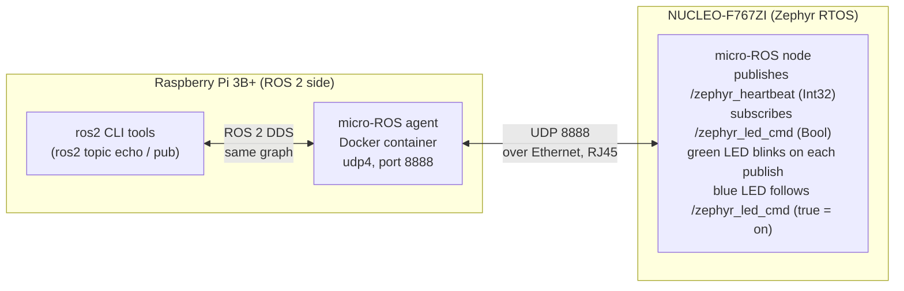

# micro-ROS on Nucleo F767ZI (Zephyr) <-> ROS 2 on Raspberry Pi 3B+

[](https://github.com/mitselec/microros_nucleo_pi/actions/workflows/ci.yml)

Two projects that talk to each other over **UDP on your LAN**:

> **Status:** verified end-to-end — Nucleo at `192.168.0.230` (Zephyr v4.1.0) ↔ Pi 3B+ running the agent in Docker. The heartbeat shows up in `ros2 topic echo` at 1 Hz, and `ros2 topic pub` switches the blue LED on/off.



| Folder | What it is |
|---|---|
| `nucleo_f767zi_microros/` | Zephyr application + west manifest. Builds `micro_ros_zephyr_module`, uses the **UDP transport** over the board's built-in Ethernet with a static IP (`192.168.0.230` by default). |
| `raspberry_pi_agent/` | ROS 2 side: the micro-ROS **agent** as a Docker service + instructions to inspect/drive topics with ros2 CLI. |
| `.github/workflows/ci.yml` | GitHub Actions build of the Zephyr firmware on every push/PR; the flashed-ready `.hex/.bin/.elf` come out as a downloadable artifact. |

## Topics

| Topic | Type | Direction | Effect |
|---|---|---|---|
| `/zephyr_heartbeat` | `std_msgs/msg/Int32` | Nucleo -> Pi | Counter, published once per second; green LED (LD1, PB0) blinks on each publish |
| `/zephyr_led_cmd` | `std_msgs/msg/Bool` | Pi -> Nucleo | `true` turns the blue LED (LD2, PB7) on, `false` turns it off |

## Quick start

1. Flash/prepare the Pi agents: see `raspberry_pi_agent/README.md` (Docker agent on `0.0.0.0:8888`).
2. Find the Pi's IP (`hostname -I` on the Pi) and put it in `nucleo_f767zi_microros/prj.conf` as `CONFIG_MICROROS_AGENT_IP="..."`.
3. Build + flash the Nucleo: see `nucleo_f767zi_microros/README.md` (build in WSL2, flash with STM32CubeProgrammer). The board comes up at a **static** `192.168.0.230` (set in `prj.conf`) — change it to a free address in the Pi's subnet if that one is taken.
4. Plug both into the same switch/router. On the Pi (the agent image has no `ros2` CLI, so use a separate container):
   ```bash
   docker run --rm --network host ros:humble \
     bash -c "source /opt/ros/humble/setup.bash && ros2 topic echo /zephyr_heartbeat"

   # blue LED on / off (a short burst makes it immune to DDS discovery races):
   docker run --rm --network host ros:humble \
     bash -c "source /opt/ros/humble/setup.bash && ros2 topic pub -r 2 --times 5 /zephyr_led_cmd std_msgs/msg/Bool '{data: true}'"
   docker run --rm --network host ros:humble \
     bash -c "source /opt/ros/humble/setup.bash && ros2 topic pub -r 2 --times 5 /zephyr_led_cmd std_msgs/msg/Bool '{data: false}'"
   ```

   Each of these containers is a **fresh DDS participant**: discovery with the agent takes a few
   seconds, so a single `--once` publish can be dropped before the two sides have matched. The
   command is a level (`true` = on), so publishing it several times is harmless.

## Releases

Pushing a version tag builds the firmware and publishes it as a **GitHub Release**
with `zephyr.hex`, `zephyr.bin` and `zephyr.elf` attached:

```bash
git tag -a v1.0.0 -m "First working demo"
git push origin v1.0.0
```

The release body contains the flashing command, and the binaries stay available
permanently — unlike workflow artifacts, which GitHub deletes after 90 days.
Re-running the workflow for an existing tag re-uploads the assets instead of
failing.

## Hardware notes

- **Ethernet**: the Nucleo-144 F767ZI has an onboard RJ45 with PHY (RMII). Connect it to the same LAN as the Pi. PA7 (crs_dv) is used by Ethernet - don't repurpose the Arduino SPI MOSI at the same time.
- **Silicon revision**: older F767ZI boards have shown flaky Ethernet in some Zephyr versions ([zephyr#26519](https://github.com/zephyrproject-rtos/zephyr/issues/26519), closed). If ping works but other traffic drops, try a different cable/switch port and check the board revision before blaming the firmware.
- ROS_DOMAIN_ID must match on both sides (default `0`).

## License

Apache-2.0 - see [LICENSE](LICENSE). This demo builds on the micro-ROS Zephyr module
([micro-ROS/micro_ros_zephyr_module](https://github.com/micro-ROS/micro_ros_zephyr_module)), which is Apache-2.0 licensed as well.
